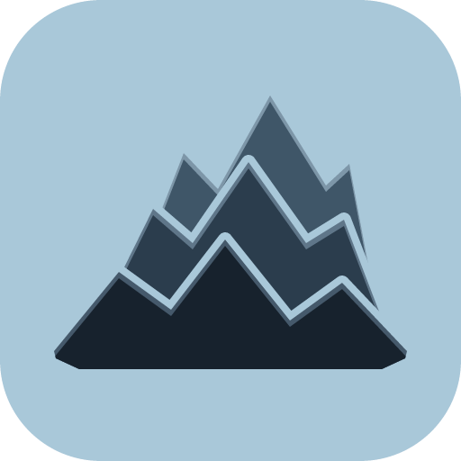

 

  
  <h3 align="center">Ridge</h3>
  
OSINT tools, sock-puppet personas and investigation graphs in one desktop app.

## Table of Contents

- [About The Project](#about-the-project)
  - [Built With](#built-with)
- [Getting Started](#getting-started)
  - [Prerequisites](#prerequisites)
  - [Installation](#installation)
- [Usage](#usage)
- [License](#license)

## About The Project

**Ridge** is a Windows desktop app for OSINT investigations. It gathers the 1,700+ tools, runs sock-puppet personas in isolated VM that cannot
reach your PC or your home network, maps what you find on investigation graphs, marks up pictures for reports, and dates pictures from their shadows.

### Built With

* 
* 
* 
* 

## Getting Started

### Prerequisites

* Windows 10 or 11
* [Docker Desktop](https://www.docker.com/products/docker-desktop/) for the personas (Ridge can install or start it for you); the other tabs work without it
* A VPN (optional but advised since the personas' browsers go online through your own connection)

### Installation

Download the latest installer (`Ridge-Setup-X.Y.Z.exe`) from the [Releases](https://github.com/Ridge-client/Launcher/releases) page and run it. It installs without administrator rights and adds Ridge to the Start menu.

The installer is not code-signed yet, so Windows may warn: click **More info**, then **Run anyway**.

Ridge keeps itself up to date: an orange dot by its version, at the right of the top bar, means a newer one is out. Click the version to see what's new and **Update now**; Ridge closes, installs it and opens again.

## Usage

* **OSINT tools**: search the catalog by name, category or type; Ridge marks each site up or down, and **Open** opens it in your browser.
* **Personas**: **Create persona** fills in an identity sheet next to ID generator sites, then **Start** opens its own browser in Docker, after a VPN, timezone and protection check. Each persona keeps its history, logins, notes and attached files.
* **Graph**: add entities from the palette (people, accounts, places, money, infrastructure…), link them, arrange them with a layout, and **Save** the graph to a file (Ctrl+S).
* **Annotate**: open a picture, draw numbered boxes on it, caption them, and **Export PNG**.
* **Shadows**: find when a picture was taken from its shadows. Type the place, the way the camera faced (or draw it on a map screenshot), where the shadows point and how long they are next to the object, and Ridge lists the dates and times the sun stood like that, with its path drawn on a sky chart. **Copy** puts the clues and candidates on the clipboard for your report.
* **Settings**: choose what the personas are kept away from (this PC, your home network, each other) and **Run checks** to prove it.

## Credits

See [AUTHORS.md](AUTHORS.md) for the complete list of contributors and historical upstream lineage.

## License

Ridge is free software under the [GNU General Public License v3.0](LICENSE).

(<a href="#readme-top">back to top</a>)

